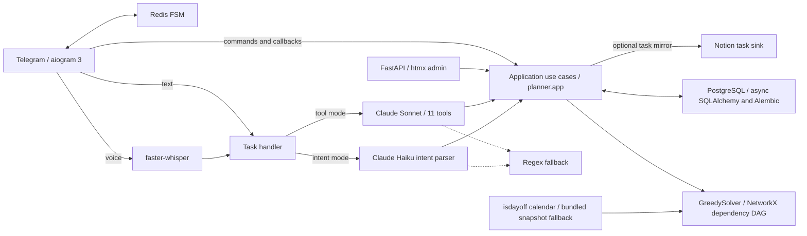

# presales-planner

Schedule presales work across a team using task dependencies, deadlines, and individual capacity.

[](https://github.com/Gleb-Sergeevich-Loktionov/presales-planner/actions/workflows/ci.yml)     

## Key Engineering Highlights

- The optional Claude Sonnet tool loop exposes 11 tools for planning, team lookup, workload queries, and task edits. Write tools check the caller’s role.
- Claude Haiku parses task intents on the standard path. Both Claude paths have regex fallbacks, and faster-whisper transcribes Telegram voice messages locally.
- The NetworkX-based `GreedySolver` schedules a dependency DAG using skills, capacity, deadlines, and working days. The `isdayoff` adapter falls back to a bundled calendar snapshot.
- Async SQLAlchemy models map 17 PostgreSQL tables across six Alembic migrations. Captured tasks can be mirrored to Notion.
- GitHub Actions runs Ruff on source and tests, strict mypy on the domain, and 580 unit tests. The complete pytest collection contains 663 tests.

## Architecture



External services sit behind ports for the solver, intent parser, calendar, repository, and transcription. The scheduling domain runs without I/O. The Notion sink is a best-effort mirror for task capture.

## Stack

Python 3.12 · aiogram 3 · FastAPI · SQLAlchemy 2 (async) · PostgreSQL 16 ·
Redis 7 · NetworkX (greedy solver) · Claude Haiku (intent parsing) ·
faster-whisper (speech-to-text) · APScheduler · matplotlib · uv.

## Quick start

```bash
# 1. Infra
docker compose up -d            # postgres + redis

# 2. Dependencies
uv sync

# 3. Config
cp .env.example .env            # fill BOT_TOKEN, ANTHROPIC_API_KEY, TEAM_CHAT_ID, ...

# 4. DB + demo seed
uv run alembic upgrade head
uv run python -m seed.load

# 5. Run (bot + web admin on :8000 + scheduler)
uv run python -m planner.main
```

The `seed/` data (team, roles/skills, task templates) is **fictional demo data** —
edit `seed/team.yaml`, `seed/capability.yaml` and `seed/tasks_*.yaml` for your own team.

## Configuration

Everything is via `.env` (see [`.env.example`](.env.example)). Key variables:

| Variable | Required | Description |
|---|---|---|
| `DATABASE_URL` | yes | Async Postgres DSN (`postgresql+asyncpg://…`) |
| `REDIS_URL` | yes | Redis connection string |
| `BOT_TOKEN` | yes | Telegram bot token from @BotFather |
| `ANTHROPIC_API_KEY` | yes | Claude API key (intent parsing) |
| `TEAM_CHAT_ID` | yes | Telegram chat id for notifications |
| `JWT_SECRET` | prod | Admin session signing secret; app refuses to start with `DEBUG=false` if unset |
| `NOTION_TOKEN` / `NOTION_DATABASE_ID` | no | Optional Telegram → Notion task mirror |
| `TIMEZONE` | no | Scheduling timezone (default `Europe/Moscow`) |
| `DEBUG` | no | Must be `false` in production (enables the loopback `/dev-login` shortcut) |

## Make targets

`make dev` · `make test` · `make cov` · `make seed` · `make migrate` ·
`make lint` · `make acceptance`

## Tests

```bash
uv run pytest tests --cov=src/planner --cov-report=term-missing
```

Three levels: **unit** (domain solver, calendar, intent, use-cases — no IO),
**integration** (db + calendar/LLM via vcrpy on a real Postgres), and
**e2e** (bot flows + web admin).

## Status

Sprints 1–6 implemented: schema + seed, greedy solver, intent parsing + bot
baseline, use-cases + PNG (Gantt/heatmap) render, FastAPI admin, observability
and an error boundary. Deferred to v2: OR-Tools/PyJobShop solver, multi-tenant,
production deploy hardening.

## Docs

- [`docs/SPEC.md`](docs/SPEC.md) — design & specification
- [`docs/architecture.md`](docs/architecture.md) — layering and ports
- [`docs/acceptance.md`](docs/acceptance.md) — acceptance scenarios

## License

[MIT](LICENSE) © 2026 Gleb Sergeevich Loktionov.
